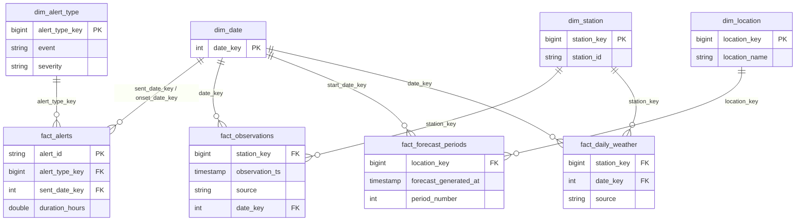

# Gold layer: dimensional model

Silver is typed and validated but shaped like the source. Gold reshapes it into a **star schema** built for
analytical reads: small descriptive **dimensions** and large, narrow **facts** joined on integer keys.

## ER diagram

## Tables

| Table | Type | Grain | Primary key | Foreign keys |
|---|---|---|---|---|
| `dim_date` | Dimension | one day | `date_key` (yyyymmdd) | none |
| `dim_station` | Dimension | one station | `station_key` | none |
| `dim_location` | Dimension | one forecast location | `location_key` | none |
| `dim_alert_type` | Dimension | event + category + severity + certainty + urgency | `alert_type_key` | none |
| `fact_alerts` | Fact | one alert | `alert_id` | `alert_type_key`, `sent_date_key`, `onset_date_key` |
| `fact_observations` | Fact | station + timestamp + source | `station_key`, `observation_ts`, `source` | `station_key`, `date_key` |
| `fact_forecast_periods` | Fact | location + forecast version + period | `location_key`, `forecast_generated_at`, `period_number` | `location_key`, `start_date_key` |
| `fact_daily_weather` | Aggregate fact | station + day + source | `station_key`, `date_key`, `source` | `station_key`, `date_key` |

Full column lists: `docs/data_dictionary.md` (Gold section, generated from `nws_pipeline/schemas.py`).

## Design decisions

- **Surrogate keys are deterministic** (`xxhash64` of the natural key). They never change between runs, so `MERGE`
  stays idempotent and facts load without a lookup join against the dimensions.
- **`dim_date` is role-playing** in `fact_alerts` (sent and onset dates). In Power BI one relationship is active and the
  other is used with `USERELATIONSHIP`.
- **Observations from two sources share one fact**; `source` stays on the fact (degenerate dimension) because it is part of the key.
- **`fact_daily_weather` is an aggregate fact** (avg/min/max/sum per station and day). It serves dashboard trends fast and
  is the pipeline's heaviest transformation (join + group-by, used for the Spark UI DAG analysis).
- **Forecast accuracy is out of scope**: Silver has no mapping from forecast locations to observation stations, so
  forecasts and observations are separate facts.

## Refresh strategy

| Table | Strategy |
|---|---|
| Dimensions | rebuilt from full Silver (small), `MERGE` on key, unchanged rows skipped via `row_hash` |
| Facts | only Silver rows whose `load_timestamp` is inside the run window, `MERGE` on grain with `row_hash` |
| `fact_daily_weather` | only (station, day, source) groups touched by the window are recomputed from all their Silver rows, so late data corrects the day |

Every table is logged to `pipeline_execution_logs` with `layer = silver_to_gold`: rows read (in `message`),
rows inserted/updated, start/end time and status.

## Read optimisation

`optimize_gold()` (notebook 04, widget `optimize = yes`) applies **Liquid Clustering** on each fact's join keys and runs
`OPTIMIZE` on all Gold tables:

| Fact | Clustered by |
|---|---|
| `fact_observations` | `date_key`, `station_key` |
| `fact_alerts` | `sent_date_key`, `alert_type_key` |
| `fact_forecast_periods` | `start_date_key`, `location_key` |
| `fact_daily_weather` | `date_key`, `station_key` |

If clustering is unavailable on the compute it falls back to `ZORDER`, then plain `OPTIMIZE`.
